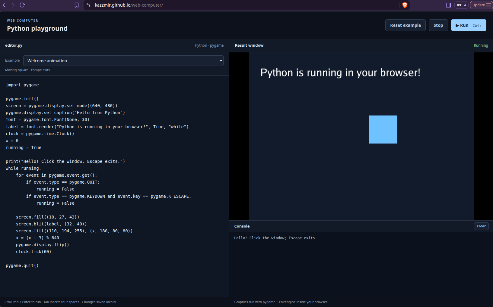

[Run the program here](https://kazzmir.github.io/web-computer/)

# About

This project enables a user to edit python code in a web browser, and use the pygame module to write simple games. The browser runs a wasm build of the golang code here, which contains a python 3.x interpreter in it. Normally pygame uses SDL as a backend, but instead the backend is replaced with [ebitengine](https://ebitengine.org/).

A best effort attempt is made at being python 3.x compatible and pygame compatible, but some things may not work as expected. Please file an issue for any unexpected results.

# AI Disclosure

GPT-6.1-Sol was heavily used in the development of this project.
